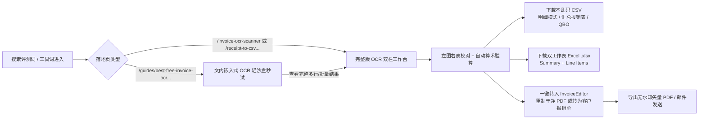

# 产品需求文档（PRD）：BillCrafter 2.0 全站升级与 Receipt & Invoice OCR 子产品

| 文档属性 | 内容详情 |
| :--- | :--- |
| **产品名称** | BillCrafter（[billcrafter.com](https://billcrafter.com)） |
| **文档版本** | v2.0（正式版） |
| **编写日期** | 2026-11-13 |
| **涉及端 / 平台** | Desktop Web（主力，占比 ~75%）+ Mobile Web（响应式相机直拍，占比 ~25%） |
| **关联文档** | 技术架构规范见 `迭代PRD-2026Q4-OCR与全站升级方案.md`；存量基线见 `PRD.md`、`UI-REDESIGN-PRD.md` |
| **核心升级摘要** | 1. 新增 **Receipt & Invoice OCR Scanner** 子功能（拍照/上传发票收据 → 提取表格 → 导出 Excel/CSV 或一键转正式 PDF 账单） 2. 新建 **`/guides` 深度评测与教程专栏**，首发《Best Free Invoice OCR Software in 2026》强攻 KD 15 评测词 3. **多语言体系修复与扩展**（修复 14 语种 `<html lang>` + 拓展 6 大高价值语种本地化 OCR/开票页） 4. **存量工具页去同质化、全站双向内链提权、视觉视频素材与全链路埋点闭环** |

---

## 一、 产品背景、商业机会与北极星目标

### 1.1 现状诊断与核心痛点
1. **SEO 底子极好，但核心词卡在“临门一脚”**：全站已有 **1,575 个 GSC 自然查询词** 和 **1.4 万+ 自然搜索曝光**，105+ 页面被 Google 收录；但存量页面均为单向静态开票模板页，核心词排名集中在 40–60 名，缺少高频复访抓手与自然外链吸引物。
2. **产品链路只有“后半截”**：自由职业者、承包商（Contractor/Handyman）和小企业主不仅需要“向外开发票（Outbound Invoicing）”，在日常经营中还面临高频痛点——**收到纸质收据、拍照小票或供应商 PDF 发票时，需要手动敲进 Excel 记账或重敲一遍做成给客户的报销账单（Inbound Expense Capture）**。
3. **商业变现天花板亟待拉高**：站点当前采用“免注册基础免费 + 注册无限免费 + Google AdSense”模式。普通模板页广告竞价偏低，而企业级财税 OCR 赛道的广告主出价极高。

### 1.2 核心商业词机会矩阵

| 关键词 | 月搜索量 | 竞争度 (KD) | CPC (USD) | 产品承接策略 |
| :--- | ---: | ---: | ---: | :--- |
| **`invoice ocr`** | 720 | **25** | **$19.30** | 新建 `/invoice-ocr-scanner` 独立工具页，承接超高商业价值企业财税需求，拉高整站 AdSense RPM |
| **`receipt photo to CSV OCR`** | 4,400 | **42** | **$2.65** | 新建 `/receipt-to-csv-converter` 工具页，主打“单张/多张收据拍照秒转不乱码 CSV & Excel 报销表” |
| **`best ocr software for invoice processing`** | 1,600 | **15** | $0.00 | 新建 `/guides/best-free-invoice-ocr-software` 实测横评长文，**正文内嵌免登录 OCR 沙盒**，以极低难度快速排进首页截流 |
| **`invoice generator`** | 673,000 | 63 | **$7.11** | 通过 OCR 工具与实测报告获取外链与高停留交互信号，经全站内链源源不断回哺根域首页 `/` |

### 1.3 产品升级定位跃迁
- **升级前（v1.x）**：免费在线发票/报价单/收据 PDF 生成器。
- **升级后（v2.0）**：**从票据识别（AI OCR to Excel/CSV）到专业开票（WYSIWYG PDF Generator）的一站式轻量财税文档工作台**——依然保持“零注册门槛、零水印、打开即用”的品牌基因。

### 1.4 阶段量化 KPI 目标

| 指标维度 | 当前基线 | 上线 +30 天目标 | 上线 +90 天目标 |
| :--- | :--- | :--- | :--- |
| **GSC 月自然曝光 / 周点击** | ~4,000 曝光/月 · <10 点击/周 | ≥ 15,000 曝光/月 · ≥ 45 点击/周 | ≥ 50,000 曝光/月 · ≥ 180 点击/周 |
| **Google Top 20 商业词数** | 1 个（consulting 18.6） | ≥ 5 个（含 KD 15 评测词进前 20） | ≥ 15 个（含 OCR 词族进前 15） |
| **OCR 工具使用激活率** | —（新功能） | 落地页访客 → 完成识别（含样张）≥ 35% | 识别完成 → 导出 CSV/Excel/转 PDF ≥ 50% |
| **评测文工具导流率** | —（新栏目） | 阅读评测文 → 页内试用或点击 OCR 页 ≥ 18% | 稳定维持 ≥ 22%，平均停留时长 > 2m30s |
| **免费账号新增注册率** | 极低（匿名 1 次 PDF 已够单次用） | OCR 重度用户触发配额转注册率 ≥ 12% | 月新增注册用户较基线提升 300% |

---

## 二、 目标用户画像与核心场景（User Personas & Stories）

| 画像角色 | 主要使用设备 | 典型触发搜索词 | 核心痛点与使用场景（User Story） |
| :--- | :--- | :--- | :--- |
| **P1：小微企业行政 / 记账员（Sarah）** | **Desktop PC（90%）** | `invoice ocr`、`pdf invoice to excel` | **场景**：每周收到十几封供应商发来的 PDF 采购发票或扫描件，不想花 $99/月买企业 ERP，只想把 PDF 拖进网页，3 秒提取出单号、日期、明细表和税额，下载成 `.xlsx` 或导入 QuickBooks。 |
| **P2：差旅人士 / 自由职业者（Leo）** | **Desktop（60%）** **Mobile（40%）** | `receipt photo to CSV OCR`、`scan receipt to excel` | **场景**：出差一周手机相册里攒了 12 张餐饮、打车、酒店热敏纸小票照片。月底报销时把照片拖进网页（或在路上直接用手机网页拍照），希望**合并导出成 1 张干净的 CSV 汇总报销单**，绝不要乱码和错行。 |
| **P3：现场承包商 / 维修工（Mike）** | **Mobile（65%）** **Desktop（35%）** | `contractor invoice generator`、`receipt scanner` | **场景**：在建材城买完油漆和管材，站在车旁用手机打开网页拍下收据，提取出材料名称与金额后，点击 **“转为客户请款发票（Bill to Client）”**，加上自己的工时费和收据照片凭证，当场生成正式 PDF 发给房主。 |
| **P4：财税工具选型者（David）** | **Desktop PC（85%）** | `best ocr software for invoice processing` | **场景**：厌倦了竞品动辄强制填公司邮箱预约销售 Demo。在阅读对比文章时，看到页面里直接嵌着免注册测试框，随手拖入一张手头的模糊发票实测，发现连分项税率都能算对，当场收藏并注册使用。 |

---

## 三、 全站信息架构（IA）与导航改造需求

### 3.1 新增与改造路由总表

| 页面层级 | 路由路径（URL） | 页面类型 | 优先级 | 核心职责 |
| :--- | :--- | :--- | :---: | :--- |
| **核心工具页** | `/invoice-ocr-scanner` | 交互工具 + SEO 指南 | **P0** | 主打发票 PDF / 图片提取表格转 Excel / CSV / 可编辑发票 |
| **核心工具页** | `/receipt-to-csv-converter` | 交互工具 + SEO 指南 | **P0** | 默认开启“多小票合并记账台”视图，主打拍照收据转 CSV / Excel |
| **长尾工具页** | `/invoice-to-excel-converter` | 交互工具 + SEO 指南 | **P1** | 承接 PDF/图片发票转 `.xlsx` 电子表格细分搜索意图 |
| **专栏聚合页** | `/guides` | 评测与实操教程列表页 | **P0** | 收录所有深度软件评测、开票合规指南与报销自动化教程 |
| **旗舰评测页** | `/guides/best-free-invoice-ocr-software` | 深度评测 + 内嵌轻沙盒 | **P0** | 7 款主流发票 OCR 工具实测对比，强攻 KD 15 高价值评测词 |
| **实操教程页** | `/guides/how-to-scan-receipts-to-excel` | 图文视频教程 + 轻沙盒 | **P1** | 手把手教用户把手机收据照片批量转为 Excel / Google Sheets |
| **存量工具页** | `/`、`/estimate-generator`、`/quote-generator`、`/receipt-maker` | 存量核心页升级 | **P1** | 接收 OCR 跳转预填数据；补充独有行业示例卡片与双向内链 |
| **多语言工具页** | `/[locale]/invoice-ocr-scanner` `/[locale]/receipt-to-csv-converter` | 本地化工具落地页 | **P2** | 首批覆盖 `de / es / fr / ja / zh-Hant / pt` 六大语种 |

### 3.2 全局导航与页脚变更规则
1. **顶部导航栏（`components/SiteNav.jsx`）**：
   - 在现有 `Templates` 右侧新增一级入口：**`Invoice OCR`**（指向 `/invoice-ocr-scanner`，带轻量 `NEW` 或 `AI` 微标，颜色使用 `--brand-wash` 底色 + `--brand-ink` 文字，不喧宾夺主）。
   - 将原指向首页锚点的 `Guide` 升级为指向 `/guides`（或在下拉/副导航可直达专栏）。
   - **移动端折叠要求**：屏幕宽度 `< 640px` 时保持顶栏单行简洁，`Invoice OCR` 保留可见，次要锚点收入菜单或页脚，严禁顶栏换行挤压首屏高度。
2. **全局页脚（`components/SiteFooter.jsx`）**：
   - `Product` 列新增：`Invoice OCR scanner`（`/invoice-ocr-scanner`）、`Receipt to CSV`（`/receipt-to-csv-converter`）、`Invoice to Excel`（`/invoice-to-excel-converter`）。
   - `Company` 或新增 `Resources` 列加入：`Guides & Reviews`（`/guides`）、`Best Invoice OCR (2026)`（`/guides/best-free-invoice-ocr-software`）。

### 3.3 核心产品流转闭环图

---

## 四、 核心子产品需求详述：Receipt & Invoice OCR Scanner（P0）

### 4.1 视觉规范与双端响应式布局
1. **严格沿用现有 Groq 浅色设计系统（`UI-REDESIGN-PRD.md`）**：
   - 背景色 `--bg: #F3F3EE`（暖骨白），工作台卡片 `--card: #FFFFFF`，主文字 `--ink: #2D2F33`，唯一强调色 `--brand: #F43E01`（仅用于主 CTA、扫描线、选中态与关键徽章）。
2. **首屏一屏可见原则（Above-the-Fold Rule）**：
   - 在 `1366×768` 桌面分辨率及 `390×844` 手机分辨率下，无需向下滚动，用户必须第一眼看到 **精简标题区 + 上传/拍照主操作框 + 3 个免上传测试样张按钮**。
3. **响应式布局切换**：
   - **未上传态（Empty State）**：居中宽卡片（最大宽度 `880px`），上方为拖拽/拍照区，下方为样张快捷体验条与隐私承诺徽章。
   - **已上传/校对态（Active Workbench State）**：
     - **桌面端（`≥ 960px`）**：展开为 `1160px` 宽的 **左右 42% : 58% 双栏分屏工作台**（左栏粘性定位固定原件图片/PDF 方便对照，右栏为结构化表单、明细表格与导出工具条）。
     - **移动端（`< 960px`）**：顶部为紧凑缩略图条（点击可全屏放大查看原票），主体为针对触屏优化的结构化卡片表单，屏幕底部悬浮 **Sticky 导出操作栏**（`Export CSV` / `Excel` / `Make PDF`）。

---

### 4.2 功能模块 F1：多通道票据输入与免上传样张体验

#### 1. 文件格式与体积规则
- **支持格式**：`JPG / JPEG`、`PNG`、`WebP`、`HEIC/HEIF`（移动端相册兼容提示或前端转码）、`PDF`（电子原生 PDF 及扫描件 PDF）。
- **单文件上限**：图片原始文件 `≤ 15 MB`（前端自动等比压缩至长边 `1600px` JPEG 后上传，实际传输约 `180–350 KB`）；PDF 文件 `≤ 4.5 MB`（默认解析前 3 页，超出页数提示拆分或截取）。
- **单次多选批量队列上限**：
  - 未登录访客：单次最多拖入/选择 **3 个文件**（刚好匹配每日免费额度）。
  - 免费登录用户：单次最多拖入/选择 **10 个文件**，前端按顺序逐张自动识别并汇总进左侧文件队列栏。

#### 2. 四种输入交互细节
1. **桌面点击与拖拽（Drag & Drop）**：文件拖入画布任意区域时，外框变为 `2px dashed #F43E01` 并高亮底色 `#FDECE5`，松手即刻进入识别队列。
2. **剪贴板快捷键直粘（Paste Screenshot）**：在当前页面任意非输入框焦点下按下 `Ctrl+V`（Windows）或 `Cmd+V`（Mac），若剪贴板包含图片数据，立即创建 `clipboard-receipt-HHMMSS.jpg` 并启动识别。上传框内需明文提示：`Drop PDF/photo, browse, or press ⌘V / Ctrl+V to paste screenshot`。
3. **移动端后置相机直拍（Camera Direct Capture）**：
   - 在移动端视口下，主按钮文案切换为 **`Snap Receipt / Invoice Photo`**（配相机图标，点击直接唤起系统后置摄像头拍照），副按钮为 **`Choose PDF or Photo from Album`**（从相册或文件管理器多选）。
4. **免上传一键试用样张（Zero-Friction Sample Bills — 转化率核心保障）**：
   - 在上传区底部常驻：`No bill handy? Try a real sample:` + 3 个可点击胶囊按钮：
     - `☕ Crumpled café receipt`（展示抗褶皱、税费与小费 Tip 提取能力）
     - `🔧 Hardware store invoice`（展示承包商多行材料、计税/免税行分离能力）
     - `📄 Consulting PDF invoice`（展示多行工时单价、PO 号与到期日提取能力）
   - **业务规则**：点击任一样张**不消耗用户每日免费额度，不调用后端大模型接口**，前端播放 `600ms` 真实扫描线动效后直接载入预置原图与标准提取数据，让新访客 1 秒体验完整的修改与导出流程。

*(P1 迭代项)* **跨端手机扫码传图（Scan with Phone）**：桌面端上传框右上角提供 `📱 Use phone camera` 按钮，点击弹出 SVG 二维码（有效期 5 分钟）。手机扫码打开极简拍照页上传后，电脑端工作台在 2 秒内自动接收原图并展示识别结果。

---

### 4.3 功能模块 F2：扫描状态机与全量异常反馈规范

每个上传的票据在队列中拥有 5 种明确状态：`Queued（排队中）` → `Scanning（AI 识别中，展示纵向红色激光扫描条动效与耗时秒表）` → `Verified（算术校验通过）` / `Review Needed（存在尾差或低置信度字段）` / `Failed（失败，不扣次数）`。

#### 异常边界处理与标准 UI 文案表（严禁抛出原始报错码）

| 异常场景 | 触发条件 | 是否扣减额度 | 前端提示文案（英文主站基准）与交互动作 |
| :--- | :--- | :---: | :--- |
| **非票据图片** | 模型返回 `isBillingDocument: false`（如自拍、风景照） | 否（计入防刷频次） | **文案**：*"This doesn't look like an invoice or receipt. Please upload a clear photo or PDF of a billing document."* **动作**：提供 `Try another file` 按钮。 |
| **图像极度模糊/遮挡** | `confidence < 0.45` 且关键总计缺失 | 是（已出部分结果） | **文案**：*"Image is blurry or partially cut off. Please double-check highlighted figures against the original."* **动作**：右栏空白或存疑字段高亮浅琥珀色背景。 |
| **不支持的文件格式** | 上传 `.doc / .zip / .exe` 等非图片/PDF | 否 | **文案**：*"Unsupported file format. Please upload a JPG, PNG, WebP image, or a PDF file."* |
| **PDF 体积超限 / 加密** | PDF `> 4.5MB` 或受密码保护无法读取 | 否 | **文案**：*"This PDF is over 4.5 MB or password-protected. Unlock it or take a screenshot (⌘V / Ctrl+V) to scan instantly."* |
| **匿名每日额度用尽** | 未登录 IP 当日已完成 3 次真实识别，发起第 4 次 | 否 | **动作**：暂存用户刚选中的文件于浏览器内存，弹出免跳转注册卡：*"You've used your 3 free guest scans today. Create a free account in 10 seconds to unlock 20 scans/day — your uploaded file will scan immediately."* |
| **登录用户日额度用尽** | 登录账号当日已完成 20 次识别 | 否 | **文案**：*"Daily fair-use limit reached (20/20 scans today). Your quota resets at 00:00 UTC. Need high-volume batch API/pack? Contact us."* |
| **突发请求过快（429）** | 单用户 10 分钟内请求 > 15 次 | 否 | **文案**：*"Scanning a bit too fast — please wait a minute and retry."* |
| **上游超时 / 网络波动** | 超过 20s 无响应或返回 `502/503` | **绝不扣减** | **文案**：*"Temporary OCR engine timeout (your free scan was NOT counted). Please click Retry."* + `Retry Scan` 按钮。 |

---

### 4.4 功能模块 F3：左图右表校对工作台与自动算术验算护栏

#### 1. 左栏：原件对照检视器（Source Document Viewer）
- **多文件切换栏**（当队列文件数 `≥ 2` 时显示）：顶部横向卡片条，展示每张票据的缩略图、识别出的商户名/文件名、金额与状态圆点（绿点=已核验，黄点=待复核，转圈=识别中），支持点击切换或删除单张。
- **图像控制条**：提供 `Zoom -`、`100%`、`Zoom +`（最高 `250%`）、`Rotate 90°`（解决横拍发票歪头看的问题）及 `Scan More +` 追加按钮。
- **隐私安全定心丸**：原件框底部固定展示盾牌图标小字：*"🔒 Privacy-first: Guest files are processed in memory and deleted immediately — never stored or used to train AI."*

#### 2. 右栏：结构化数据编辑区（字段级规范表）

| 区域 | 字段名称（UI Label） | 内部键名 | 控件类型 | 默认值 / 校验与交互规则 |
| :--- | :--- | :--- | :--- | :--- |
| **单据头部** | Document Type | `docType` | 分段单选按钮 | `Receipt` \| `Invoice` \| `Quote` \| `Estimate`（AI 自动判断，用户可一键改） |
| **单据头部** | Currency | `currency` | 下拉选择框 | 自动匹配站内 25+ 币种（如 `USD $`, `EUR €`, `GBP £`, `JPY ¥`），未识出默认 `USD` |
| **收款/开票方** | Vendor / Merchant | `vendorName` | 单行文本输入 | 商户或供应商名称（如 `Home Depot`） |
| **收款/开票方** | Vendor Info & Tax ID | `vendorDetails` | 折叠多行文本 | 地址、电话、邮箱、税号（EIN / VAT / GST / ABN），有内容时默认展开 2 行 |
| **付款/客户方** | Bill To / Customer | `clientName` | 单行文本输入 | 小票无抬头时留空，Invoice 模式下展示 |
| **单据元数据** | Number (#) | `documentNumber` | 单行文本输入 | 发票号或小票流水号 |
| **单据元数据** | Date | `issueDate` | 日期选择器 | 标准化为 `YYYY-MM-DD`，无法识别时留空并标灰提示 |
| **单据元数据** | Due Date | `dueDate` | 日期选择器 | 仅当 `docType !== "receipt"` 时显示 |
| **单据元数据** | Payment Method | `paymentMethod` | 文本输入/建议词 | 如 `Visa *4242`、`Cash`、`ACH`、`Zelle` |
| **明细表格** | Line Items | `lineItems[]` | 可增删动态表格 | 每行包含：`Description`（必填文本）、`Category`（下拉费用分类：`Materials / Meals / Travel / Software / Office / Labor / Utilities / Other`）、`Qty`（数字，默认 `1`）、`Unit Price`（数字）、`Tax?`（复选框）、`Line Total`（修改 Qty 或单价时自动联动计算，也允许手动覆盖） + 行尾删除按钮 + 底部 `+ Add line` |
| **金额汇总区** | Subtotal | `subtotal` | 数值输入/自动求和 | 提供开关：默认实时等于明细行之和，也可手动对比原票 |
| **金额汇总区** | Discount / Shipping | `discountAmount` / `shippingAmount` | 数值输入 | 为 0 时收起为 `+ Add discount / shipping` 轻量按钮，保持界面清爽 |
| **金额汇总区** | Tax & Tip | `taxAmount` / `tipAmount` | 数值输入 | 餐饮收据自动显示 `Tip`（小费）栏；普通发票仅显示 `Tax` |
| **金额汇总区** | **Total** | `total` | 加粗数值输入 | 票面最终应付/实付总额 |

#### 3. 核心差异化亮点：自动算术验算护栏（Math Sanity Check）
财务和报销用户最怕 OCR 把 `$18.00` 看成 `$13.00` 而自己没发现。系统在前端实时执行公式校验：
$$\text{ComputedTotal} = \sum \text{lineItems.amount} - \text{discountAmount} + \text{shippingAmount} + \text{taxAmount} + \text{tipAmount}$$
$$\Delta = |\text{ComputedTotal} - \text{ExtractedTotal}|$$

- **状态 1：完全吻合（$\Delta \le 0.02$ 且至少有 1 行有效金额）**
  - UI 表现：汇总区上方展示清爽绿色横幅 **`✓ Math verified — Line items + tax match the document total ($148.50).`**
- **状态 2：存在差额（$\Delta > 0.02$）**
  - UI 表现：展示醒目浅琥珀色横幅 **`⚠ Math check: Line items + tax equal $138.50, which is $10.00 off from the scanned total ($148.50).`**
  - 快捷修复按钮：右侧紧跟按钮 **`Set Total to $138.50`** 或 **`Add $10.00 adjustment line`**，用户点一下即可平账！

---

### 4.5 功能模块 F4：三大导出与开票闭环规范

工作台右上角与底部操作区提供 3 个核心出口：

#### 出口 1：`Export CSV`（主打 `receipt photo to CSV OCR` 场景）
点击按钮支持选择预设格式（默认记住用户上次选择），所有 CSV 均前置 **`\uFEFF`（UTF-8 BOM）** 并严格遵循 RFC 4180 双引号转义规则：

1. **格式 A：`Itemized Lines CSV`（默认 — 适合单张/多张发票入库）**
   - 表头列序：`File_Name, Doc_Type, Document_No, Issue_Date, Due_Date, Vendor_Name, Client_Name, Currency, Line_No, Category, Description, Quantity, Unit_Rate, Taxable, Line_Amount, Doc_Tax, Doc_Tip, Doc_Total, Payment_Method`
2. **格式 B：`Expense Report Ledger CSV`（在 `/receipt-to-csv-converter` 页面设为默认 — 1 张收据生成 1 行汇总，最适合员工报销单！）**
   - 表头列序：`Date, Vendor, Receipt_No, Primary_Category, Items_Summary, Currency, Subtotal, Tax, Tip, Total, Payment_Method, Notes`
3. **格式 C：`QuickBooks / Xero Import CSV`（会计软件友好表头）**
   - 表头列序：`*ContactName, *InvoiceNumber, *InvoiceDate, *DueDate, Description, *Quantity, *UnitAmount, *AccountCode, *TaxType, Currency`
- **文件命名规则**：单张导出命名为 `{VendorSlug}-{IssueDate || 'scan'}.csv`；多张合并导出命名为 `billcrafter-receipts-{YYYY-MM-DD}({N}-files).csv`。

#### 出口 2：`Download Excel (.xlsx)`（主打企业财务用户）
- 生成标准原生 `.xlsx` 工作簿，内含 **2 个格式化工作表**：
  - **Sheet 1 `Summary`**：每张识别票据一行，包含抬头、日期、币种、不含税小计、税额、小费、总额及验算状态（金额列设为两位小数货币数值类型，底部自带 `SUM` 求和行，绝非纯文本字符串！）。
  - **Sheet 2 `Line Items`**：展开所有票据的全部商品/服务行明细，通过 `Document_No` 与 Sheet 1 关联。

#### 出口 3：`Open in Invoice Editor (PDF) →`（独家护城河：无缝桥接现有开票器）
点击展开两个清晰选项，利用 `sessionStorage` 将结构化快照一键送入 `components/InvoiceEditor.jsx`：
1. **`Recreate as Clean PDF Invoice / Receipt`（重制高清无水印 PDF）**：
   - 适用场景：手写单据、模糊纸质收据想重制成一张带自己 Logo、排版精美的电子 PDF 存档或重发给客户。
   - 映射逻辑：1:1 填充 `From`、`Bill To`、`No.`、日期、币种、全部明细行与反推税率，跳转到首页编辑器锚点 `/#editor`（或当前页就地展开编辑器），立即可选 45 套模板下载矢量 PDF。
2. **`Bill Expenses to Client →`（将采购小票一键转为向客户请款的报销发票）**：
   - 适用场景：承包商买材料、顾问垫付差旅费后向甲方请款。
   - 映射逻辑：将当前队列中所有已识别的小票自动汇总进 `InvoiceEditor` 的 **`Reimbursable Expenses` 分组标题行**下（每张小票或每个明细生成一行：`[Date] Vendor — Description`），自动把 `From` 填入用户已保存的企业抬头，并支持勾选 **“Attach receipt photos to PDF（将原票压缩图自动放入发票底部 `Job Photos` 凭证区）”**！

---

### 4.6 功能模块 F5：使用配额与无损注册转化漏斗

| 权益项 | 未登录访客（Guest） | 免费注册账号（Free Account — $0） |
| :--- | :--- | :--- |
| **预置测试样张体验** | 无限次 | 无限次 |
| **每日 AI OCR 真实票据识别数** | **3 张 / 天**（按 IP，UTC 0 点重置） | **20 张 / 天**（按账号，UTC 0 点重置） |
| **单次上传队列文件数** | 最多 3 张合并导出 CSV/Excel | **最多 10 张**批量识别合并导出 CSV/Excel |
| **转入编辑器导出无水印 PDF** | 1 份 / 天 | **无限份** + 电子签名 + 分享链接 + 历史云端保存 |

- **透明额度条设计**：在工作台右上角温和显示剩余次数徽章，如 `Free scans today: 2 of 3 left · Sign in free for 20/day`。
- **超额“零丢稿”无缝接续体验（关键 UX 要求）**：当匿名用户拖入第 4 张图片触发配额弹窗时，复用现有的内嵌登录/自动创建账号弹窗（或 Magic Link）。**登录成功瞬间，弹窗自动关闭并立即继续扫描刚才挂起的文件**，绝不允许刷新页面导致用户刚校对好的前 3 张小票表格丢失！

---

## 五、 评测专栏（`/guides`）与存量核心页升级需求

### 5.1 `/guides` 专栏模板产品规范（P0）
为承接信息型与选型对比型搜索流量，新建轻量级、高转化、零博客臃肿感的专业指南系统：
1. **文章页顶部信任区**：面包屑导航（`Home / Guides / Invoice OCR`）+ H1 + 副标题 + 复用站内 `<Byline />`（展示金融从业作者 `Philips`、职责介绍与精确更新日期）。
2. **首屏目录导航（Sticky / Band TOC）**：快速跳转各评测小节，辅助触发 Google 搜索结果 Sitelinks。
3. **文内可嵌入交互组件（`<OcrMiniSandbox />`）**：支持通过配置在文章任意段落之间插入精简版 OCR 体验框（含拖拽上传 + 3 个样张一键体验按钮；识别完成后自动展开迷你结果表，并提供 `Open Full Table & Export Excel →` 引导进入完整工作台）。

### 5.2 首发旗舰专题：《Best Free Invoice OCR Software in 2026》（P0）
- **URL**：`/guides/best-free-invoice-ocr-software`
- **主攻词**：`best ocr software for invoice processing`（月搜 1,600，KD 15）及 `free invoice ocr software` 词簇。
- **产品内容硬性模块**：
  1. **首屏 30 秒选型速览表（Comparison Matrix）**：包含列：`Tool Name`、`Best For`、`Truly Free Tier`、`Signup Required?`、`Line-Item Accuracy (Tested)`、`Exports`。
  2. **第 2 屏内嵌实时测试沙盒**：紧接对比表下方放置 `<OcrMiniSandbox />`，配引导语：*“Don't take marketing pages at face value — test your hardest invoice or receipt right here with zero sign-up.”*
  3. **公开实测基准说明（How We Tested）**：展示同一套 3 张标准测试单据（褶皱热敏纸、分项计税材料单、多行咨询 PDF）在各款软件下的真实提取表现与耗时，并提供测试样张包下载链接（提升专业可信度与外链引用率）。
  4. **7 款工具客观深度评测卡片**：依次评测 **BillCrafter Invoice & Receipt OCR**、**Nanonets**、**Rossum**、**Dext Prepare**、**Klippa DocHorizon**、**Veryfi / Mindee**、**Google Document AI**。每张卡片统一包含：`Pros`、`Cons / Catch`、`Pricing & Free Limits`、`Who should pick it`（保持客观克制：大型 ERP 三单匹配推荐 Rossum/Nanonets；免注册秒转 CSV/Excel 与开票联动首选 BillCrafter）。
  5. **文末 FAQ（带 `FAQPage` Schema）** + 相关工具卡片内链。

### 5.3 存量核心工具页差异化升级（合并推进 P1）
吸收既有 Q4 规划，彻底解决存量核心页模板化重复问题：
- `/estimate-generator`：编辑器下方新增 **4 个行业完整估价示例切换卡**（装修、维修、摄影、清洁），点击 **`Use this example in editor →`** 直接将明细、有效期与排除条款预填入上方编辑器。
- `/quote-generator`：新增 **`Quote vs. Estimate vs. Invoice` 决策对比表** + 报价单一键转发票可视化说明。
- `/receipt-maker`：新增 **4 类高频收据场景示例卡**（现金收据、刷卡收据、定金部分付款收据、全额结清收据）+ 引导横幅 *“Already holding a paper receipt? Scan receipt photo to CSV or Excel →”* 双向导流至 `/receipt-to-csv-converter`。

---

## 六、 多语言（i18n）、SEO/GEO 与商业化广告位需求

### 6.1 多语言产品需求
1. **修复现有 14 个非英语首页语言属性（P0）**：确保访问 `/es`、`/de`、`/fr`、`/ja`、`/zh-Hant` 等所有本地化页面时，服务端返回的 HTML 根节点 `<html lang="...">` 与当前语种严格一致，且不牺牲任何页面的静态加载速度（SSG）。
2. **语言切换器路由回退兼容**：当用户在尚未翻译的英文专属页（如 `/guides/*`）切换语言时，平滑跳转至对应语种首页；当该工具页已完成对应语种本地化（加入 `LOCALIZED_PATHS`）时，直接保持在对应语种的同一工具页。
3. **首批 6 大高价值语种本地化 OCR 工具页（P2）**：
   - 范围：德语（`/de`）、西班牙语（`/es`）、法语（`/fr`）、日语（`/ja`）、繁体中文（`/zh-Hant`）、葡萄牙语（`/pt`）。
   - 本地化深度要求：**不仅是界面按钮翻译**，必须同步本地化页面示例样张货币、当地税种术语（如德国 `MwSt.`、西班牙 `IVA / IRPF`、日本 `適格請求書登録番号 T番号`、台湾 `統一編號`）以及母语级 FAQ，达标一个上线一个 `hreflang`。

### 6.2 新增页面 SEO 元数据与 Schema 定稿表

| 路由 | Meta Title（严格 ≤ 60 字符） | Meta Description（≤ 158 字符） | 必配 JSON-LD Schema |
| :--- | :--- | :--- | :--- |
| `/invoice-ocr-scanner` | `Free Invoice OCR Scanner – Extract PDF & Photo to Excel` | `Extract vendor details, line items, tax, and totals from any PDF or photo invoice in seconds. Download clean Excel (.xlsx) or CSV — free, no sign-up.` | `SoftwareApplication` + `HowTo` + `FAQPage` |
| `/receipt-to-csv-converter` | `Receipt Photo to CSV & Excel Converter – Free AI OCR` | `Snap or upload receipt photos and convert them into a clean CSV or Excel expense spreadsheet in seconds. Batch scan receipts — 100% free, no sign-up.` | `SoftwareApplication` + `HowTo` + `FAQPage` |
| `/invoice-to-excel-converter` | `Free PDF Invoice to Excel & CSV Converter Online` | `Convert PDF and image invoices into structured Excel (.xlsx) workbooks with separate summary and line-item sheets. Free online AI OCR, no sign-up.` | `SoftwareApplication` + `FAQPage` |
| `/guides/best-free-invoice-ocr-software` | `7 Best Free Invoice OCR Software in 2026 (Tested)` | `We tested 7 free invoice OCR tools on crumpled receipts, multi-tax trade bills, and PDFs. Compare accuracy, limits, and try live extraction with no sign-up.` | `Article` + `ItemList` + `FAQPage` |
| `/guides/how-to-scan-receipts-to-excel` | `How to Scan Receipt Photos to CSV & Excel Free (2026)` | `Step-by-step guide to turning phone receipt photos into clean Excel or Google Sheets expense reports without manual typing. Free online tool included.` | `Article` + `HowTo` + `FAQPage` |

- **AI 搜索优化（GEO — `public/llms.txt`）**：同步在 `llms.txt` 中补齐新增的 3 个 OCR 工具页、2 篇指南页链接以及免费配额说明（匿名 3 张/日，免费账号 20 张/日，零水印，支持 CSV/XLSX/PDF 全链路），确保 ChatGPT / Perplexity / Claude 引用最新准确产品事实。

### 6.3 高 CPC AdSense 广告位体验规范
1. **允许展示位置**：
   - OCR 工具页：工作台主体完成区**下方**（`Anatomy / How it works` 与 `FAQ` 之间 `AD_SLOTS.inContent`，以及页脚上方 `AD_SLOTS.bottom`）。
   - `/guides/*` 评测与教程页：第 2 屏交互沙盒下方、第 4 款与第 5 款评测卡片之间、文章末尾。
2. **用户体验红线（严禁违规）**：
   - **严禁**在上传框、左图右表校对台内部、导出按钮附近 `48px` 范围内放置任何广告，杜绝误触与廉价工具站观感。
   - 广告容器必须预留最小高度或静音折叠，确保页面 **CLS（累积布局偏移）< 0.05**。

---

## 七、 视觉、样张与视频素材需求清单（Asset Deliverables）

所有图形素材统一采用项目既有品牌色板（Bone `#F3F3EE` · Ink `#2D2F33` · Orange `#F43E01` · Paper `#FFFFFF`）及 `Montserrat` 字体体系：

| 素材编号 | 交付文件路径 | 尺寸 / 格式 | 内容与用途说明 |
| :--- | :--- | :--- | :--- |
| **A-01** | `public/anatomy/ocr-scanner.png` | `1040×720` PNG (2x) | **OCR 识别解剖图**：左绘倾斜纸质票据并标注 6 个红点锚点（商户、单号日期、明细行、税额、总额、支付方式），右连线指向结构化表格，用于 OCR 落地页 |
| **A-02** | `public/steps/ocr-step-1..3.png` | `720×460` PNG ×3 | **三步操作插画**：① 拍照或拖入 PDF/照片 → ② 左图右表自动核对总计 → ③ 导出 Excel/CSV 或一键转正式 PDF |
| **A-03** | `public/samples/sample-coffee-receipt.jpg` `public/samples/sample-hardware-invoice.png` `public/samples/sample-consulting-invoice.pdf` | 真实比例票据样张 ×3 | **脱敏合成测试集**：全部采用虚构商户名（如 *Roast & Co. Café*、*Summit Supply Co.*），用于工作台“免传图一键试用”及评测文实测公开下载包 |
| **A-04** | `public/og/invoice-ocr-scanner.png` 等 5 张 | `1200×630` PNG ×5 | 新增 3 个 OCR 工具页 + 2 篇评测教程页的专属社交分享 OpenGraph 大图 |
| **V-01** | 官方 YouTube 频道 + 页内嵌入 | `1920×1080` · 60–90 秒 | **实操演示视频**：演示桌面端拖入 PDF 秒出 Excel + 手机拍建材小票一键转为客户请款 PDF，带双语/英文字幕并接入 `VideoObject` Schema |

---

## 八、 数据埋点字典与管理后台（`/admin`）监控需求

### 8.1 全站关键事件埋点字典（统一由 `lib/analytics.js` 双写 GA4 与 `/api/track`）
> **隐私铁律**：任何埋点事件参数**严禁携带**用户上传的文件名、商户名称、客户姓名、邮箱或具体票面金额！

| 事件名称 | 触发时机 | 携带参数（Params） | GA4 Key Event |
| :--- | :--- | :--- | :---: |
| `ocr_sample_try` | 点击 3 个免上传测试样张之一 | `sample_id` (`coffee`/`hardware`/`consulting`), `landing_slug` | 否 |
| `ocr_scan_start` | 用户真实发起图片/PDF/粘贴识别 | `file_type` (`image`/`pdf`/`paste`), `batch_size`, `landing_slug`, `signed_in` | 否 |
| `ocr_scan_success` | OCR 成功返回结构化结果 | `doc_type`, `line_count`, `math_verified` (`true`/`false`), `latency_ms` | **是 ✅** |
| `ocr_scan_failed` | OCR 识别失败或非票据拦截 | `reason` (`not_bill`/`timeout`/`too_large`/`quota`), `landing_slug` | 否 |
| `export_csv` | 点击下载 CSV 文件成功 | `preset` (`itemized`/`ledger`/`accounting`), `file_count`, `landing_slug` | **是 ✅** |
| `export_xlsx` | 点击下载 Excel `.xlsx` 成功 | `file_count`, `landing_slug` | **是 ✅** |
| `ocr_to_editor` | 点击将 OCR 结果转入 `InvoiceEditor` | `handoff_mode` (`recreate`/`bill_expenses`), `landing_slug` | **是 ✅** |
| `ocr_quota_gate` | 触发匿名 3 次额度上限弹出注册框 | `landing_slug` | 否 |
| `generate_pdf` | 编辑器成功下载 PDF（存量核心事件） | `doc_type`, `template_id`, `from_ocr` (`true`/`false`), `landing_slug`, `signed_in` | **是 ✅** |
| `sign_up` | 完成免费账号注册（含从 OCR 弹窗转化） | `method`, `trigger_source` (`nav`/`pdf_quota`/`ocr_quota`) | **是 ✅** |

### 8.2 管理后台（`/admin`）新增监控需求（P1）
在现有 `/admin` 控制台的 `Overview` / `Traffic` 面板中新增 **OCR 运营监控小卡**：
- 今日已用全局额度 / 熔断上限（如 `142 / 3,000 scans today UTC`），方便直观掌控 Google Cloud API 日消耗（1,000 次 ≈ $0.35）。
- 近 7 日 OCR 真实扫描次数、导出格式分布（CSV vs Excel vs 转开发票 PDF）以及从 OCR 触发的新增注册账号数。

---

## 九、 非功能性需求、法务合规与不做边界

### 9.1 性能与稳定性指标
1. **页面加载性能**：所有公开工具页与指南页保持 Next.js 静态预渲染（SSG），移动端 Lighthouse Performance ≥ 90，LCP < 2.2s，CLS < 0.05。
2. **OCR 响应 SLA**：单张经前端压缩的票据图片，P50 识别耗时 **≤ 2.2 秒**，P95 耗时 **≤ 4.0 秒**。

### 9.2 隐私政策（`app/privacy/page.jsx`）合规更新要求（上线必改）
上线 OCR 功能同步更新 `/privacy` 页面（更新 `UPDATED` 日期）：
1. 在 `1. Information we collect` 中补充 **OCR Document Uploads** 条款：明确说明未登录访客上传的票据图片/PDF 仅在内存中用于即时文字提取，请求完成后立即丢弃，不在服务器持久化存储。
2. 在 `5. How we share information` 中新增服务商披露：**Google Cloud (Vertex AI)** — 作为企业级文档视觉解析处理方，按 Google Cloud 数据处理条款不留存客户文档且不用于训练基础模型；以及 **Google Analytics & Google AdSense** 的常规 Cookie 说明。

### 9.3 本期明确不做事项（Non-Goals / Out of Scope）
1. **不做重型记账/会计系统**：不做银行卡流水自动同步（Plaid）、不做复式记账总账（General Ledger）、不做自动报税申报。
2. **不做与 QuickBooks / Xero 的 OAuth API 直连同步**：本期通过导出兼容表头的标准 CSV/XLSX 满足 95% 中小用户导入需求，避免陷入漫长的第三方应用商店审核与维护泥潭。
3. **不做原生 iOS / Android App**：全力打磨 Mobile Web 相机直拍与响应式体验，零安装成本承接搜索引擎即搜即用流量。
4. **不盲目铺开全量 27 个市场变体的机翻内页**：严格遵守“有真实母语级本地化税制内容才开索引与 hreflang”原则，防止产生低质重复页拖累整站权重。

---

## 十、 上线验收清单（UAT Acceptance Checklist）

- [ ] **UAT-01 免上传样张体验**：隐身窗口打开 `/invoice-ocr-scanner`，依次点击 3 个样张按钮，均在 1 秒内展示左图右表完整数据，且右上角免费剩余额度保持 `3 of 3` 不扣减。
- [ ] **UAT-02 桌面拖拽与截图粘贴**：拖入 1 张五金发票 PNG + 按 `Ctrl+V / Cmd+V` 粘贴 1 张小票截图，均在 3 秒内识别成功；算术相符时显示绿色 `✓ Math verified`；人为改大某行单价时立即切换为琥珀色差额提示。
- [ ] **UAT-03 移动端实机拍照**：使用 iPhone Safari 与 Android Chrome 打开 `/receipt-to-csv-converter`，点击 `Snap Receipt` 直接拉起后置摄像头拍一张纸质小票（原图 > 5MB），前端自动压缩并在 3 秒内识别出明细，底部吸底栏可正常下载 CSV。
- [ ] **UAT-04 CSV 与 Excel 格式校验**：识别含中文、欧元符号 `€`、带英文逗号商品名（如 `"Paper, A4, 500pk"`）的票据，导出的 CSV 用系统 Excel 直接双击打开**无乱码、不错列**；导出的 `.xlsx` 包含 `Summary` 与 `Line Items` 两个工作表且金额可正常参与公式求和。
- [ ] **UAT-05 转开发票闭环**：在 OCR 结果页点击 `Recreate as Clean PDF Invoice` 与 `Bill Expenses to Client`，均能正确跳转并预填进 `InvoiceEditor`，点击 `Download PDF` 成功下载无水印矢量 PDF。
- [ ] **UAT-06 配额拦截与零丢稿接续**：匿名状态下完成 3 次真实扫描后拖入第 4 张，准确弹出免费注册引导框；完成邮箱注册/登录后，刚才拖入的第 4 张自动完成扫描，前 3 张队列数据完好无损。
- [ ] **UAT-07 评测页与 SEO/多语言校验**：打开 `/guides/best-free-invoice-ocr-software` 文内沙盒可正常交互；检查页面源码 JSON-LD 零报错；请求 `/es`、`/de`、`/zh-Hant` 服务端源码分别输出对应的 `<html lang="...">`，且 `npm run build` 所有公开落地页均为静态标识（`○ / ●`）。
